# Predicting Learner Participation in Student Opportunities

**Team 4 · AI-Powered Data Analysis Remote Internship (Excelerate)**

An end-to-end analysis of 8,558 learner-opportunity records from the RIT Student Opportunity Platform: data cleaning, feature engineering, exploratory analysis, three predictive models, and a demand forecast, with recommendations for program stakeholders.

> **Data note:** The dataset was provided by Excelerate for the internship. It contains personal information , so it is **not included** in this repository.

---

## Key Findings

| | |
|---|---|
| **Scope** | 8,558 learner-opportunity records · 22 opportunities · 5 categories · 70 countries |
| **Main finding** | Internships are **63%** of applications but only **21.5%** reach participation, versus **84–97%** for every other category |
| **Best model** | Gradient Boosting: **91.3% accuracy**, **0.970 ROC-AUC** (25% held-out test set, 2,140 records) |
| **What drives participation** | Opportunity category (especially Internship) and opportunity duration. Gender, country and major add little |
| **Trend** | Application volume keeps rising while participation rate falls, pointing to an allocation bottleneck rather than a demand problem |

---

## Repository Structure

```
├── README.md
├── figures/                 # Charts used in this README
└── reports/
    ├── Week1_Understanding_the_Dataset.pdf
    ├── Week2_Cohort_Analysis.pdf
    ├── Week3_Models_and_Predictions.pdf
    └── Week4_Final_Presentation.pdf
```

| Week | Focus | Report |
|---|---|---|
| 1 | Dataset understanding, data dictionary, quality assessment, historical trends | [PDF](reports/Week1_Understanding_the_Dataset.pdf) |
| 2 | Cleaning, feature engineering, cohort analysis | [PDF](reports/Week2_Cohort_Analysis.pdf) |
| 3 | Model training, evaluation, predictions, forecast | [PDF](reports/Week3_Models_and_Predictions.pdf) |
| 4 | Final stakeholder presentation and recommendations | [PDF](reports/Week4_Final_Presentation.pdf) |

---

## 1. Dataset and Cleaning

Each row links a learner to one opportunity and records their participation status (Applied, Started, Team Allocated, Waitlisted, Rejected, Withdraw, Dropped Out, Rewards Award).

Cleaning highlights:

- **Corrupted timestamps** (295 sign-up values): invalid hours such as `24:00` and spurious digits glued onto the hour were normalized; the calendar dates were valid and preserved, and affected rows were flagged.
- **Institution names** standardized for casing and whitespace (2,089 raw variants reduced to about 1,800).
- **Illogical date sequences** flagged rather than silently corrected: 99 records with Apply Date before Signup, and 116 with End Date before Start Date.
- **Missing Opportunity Start Date** in 44% of records, left as missing; duration analysis uses dates only.
- **Placeholder or test entries** (36 first names, 1 implausible date of birth) flagged, not removed.

**Target variable:** `participated = 1` if status is Started, Team Allocated or Rewards Award; `0` otherwise. Classes are close to balanced (47.6% participated).

---

## 2. Exploratory Analysis

### Internships dominate volume

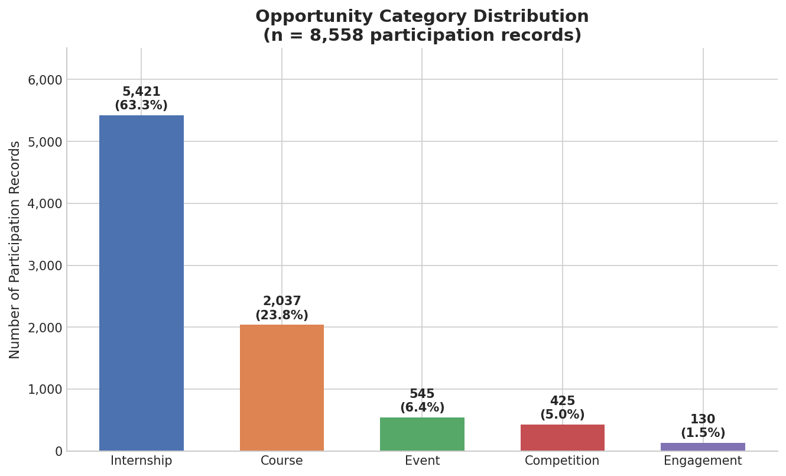

### The Internship bottleneck

Internships have a **78% exit rate** (mostly Rejected, 66%, and Dropped Out, 11%), versus under 2% for every other category. "Rejected" appears only in Internships. Health Care Management is the one Internship above 50% positive (54.9%); every other Internship sits between about 11% and 22%.

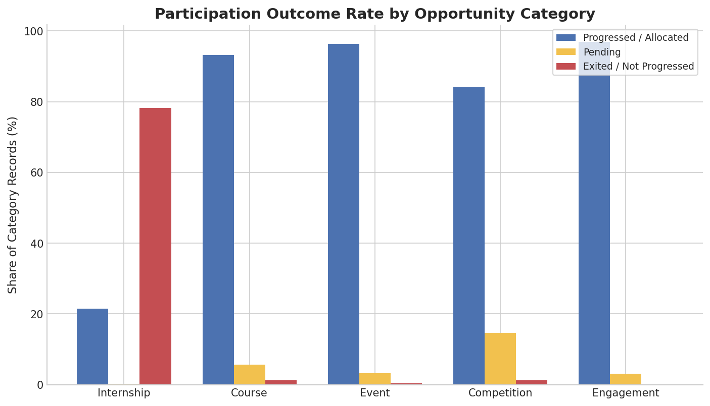

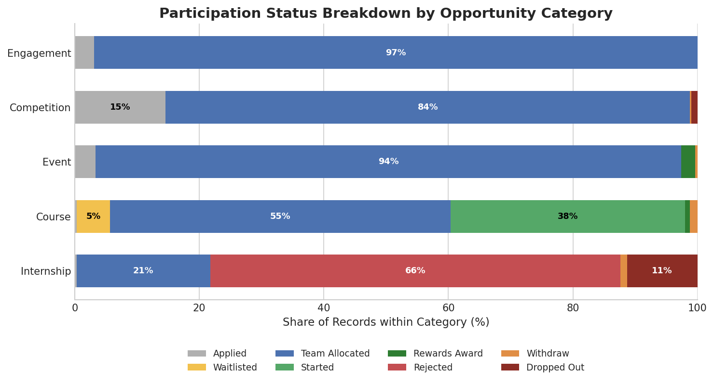

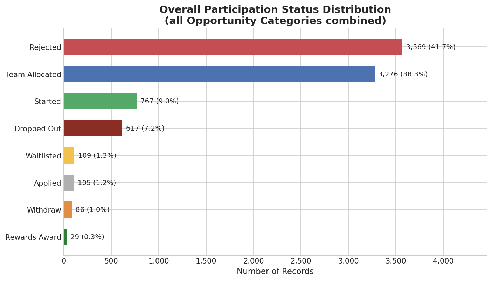

### Two-wave seasonal growth

Applications peak around the start of academic terms (August 2023 and January 2024), with Internships driving both peaks. The January 2024 surge is by far the largest in the data.

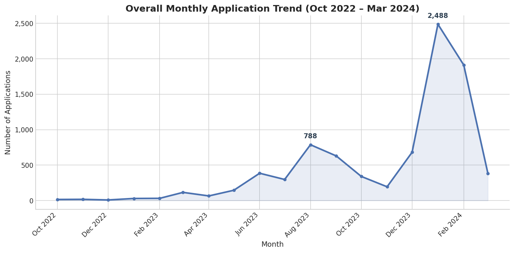

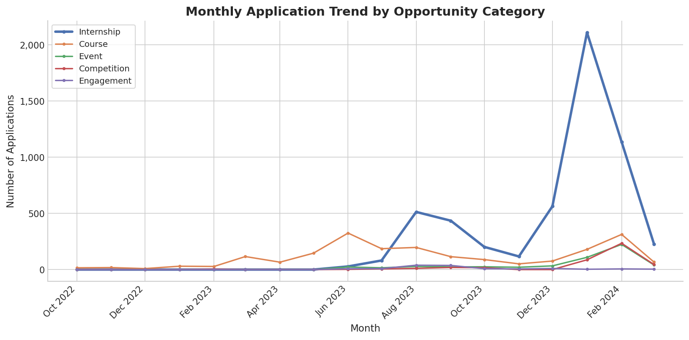

### Geography and timing

The United States (46.5%) and India (33.1%) account for nearly 80% of records. Sign-ups concentrate on Thursday and Friday.

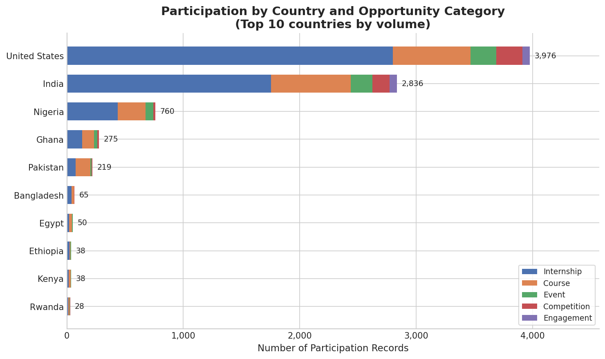

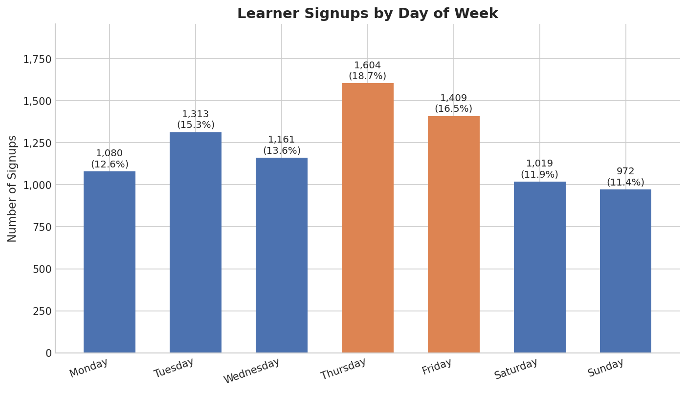

---

## 3. Predictive Modeling

Three classifiers share one scikit-learn pipeline (median imputation and scaling for numeric features, most-frequent imputation and one-hot encoding for categoricals; 75/25 split, `random_state=42`):

- **Logistic Regression**: interpretable baseline
- **Random Forest**: 300 trees, `max_depth=10`
- **Gradient Boosting** (primary): 300 estimators, `max_depth=3`, `learning_rate=0.05`

Identifier and leakage-prone columns (opportunity ID/name, institution, first name, post-outcome dates) were excluded by design.

| Metric | Logistic Regression | Random Forest | Gradient Boosting |
|---|---|---|---|
| Accuracy | 82.0% | 91.1% | **91.3%** |
| Precision | 82.6% | 92.1% | **93.4%** |
| Recall | 79.5% | **89.4%** | 88.3% |
| F1 | 81.0% | 90.7% | **90.8%** |
| ROC-AUC | 0.920 | 0.968 | **0.970** |

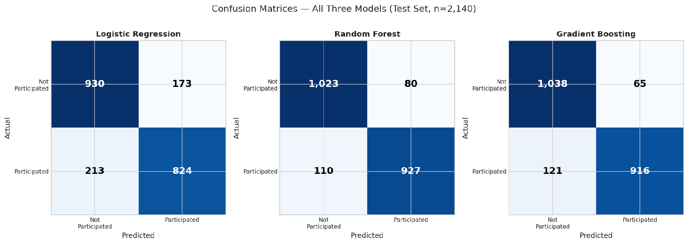

Random Forest misses fewer true participants (110 vs 121 false negatives), which suits outreach. Gradient Boosting over-promises fewer slots (65 vs 80 false positives), which suits capacity planning. The better model depends on which error costs more.

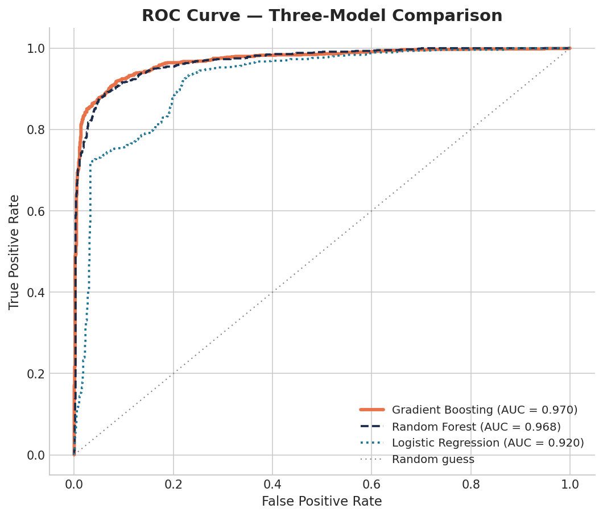

### Predicted participation by opportunity

Averaged predicted probabilities track each opportunity's actual rate closely. Two opportunities (AI Ethics Challenge, 55 records; Slide Geeks, 4 records) have small samples and are lower confidence.

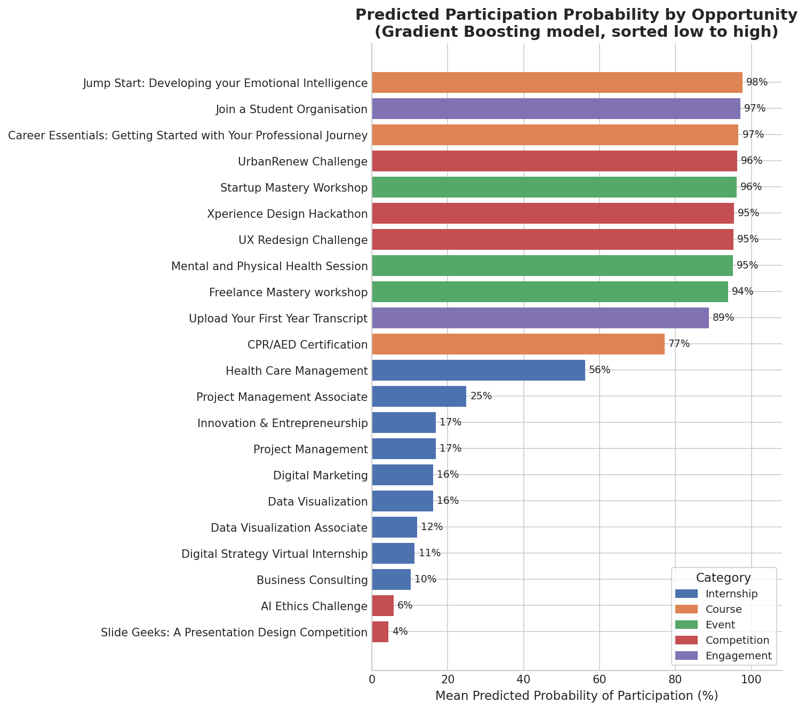

### What drives the predictions

Category and duration explain most of what the models learn; demographic features rank lowest.

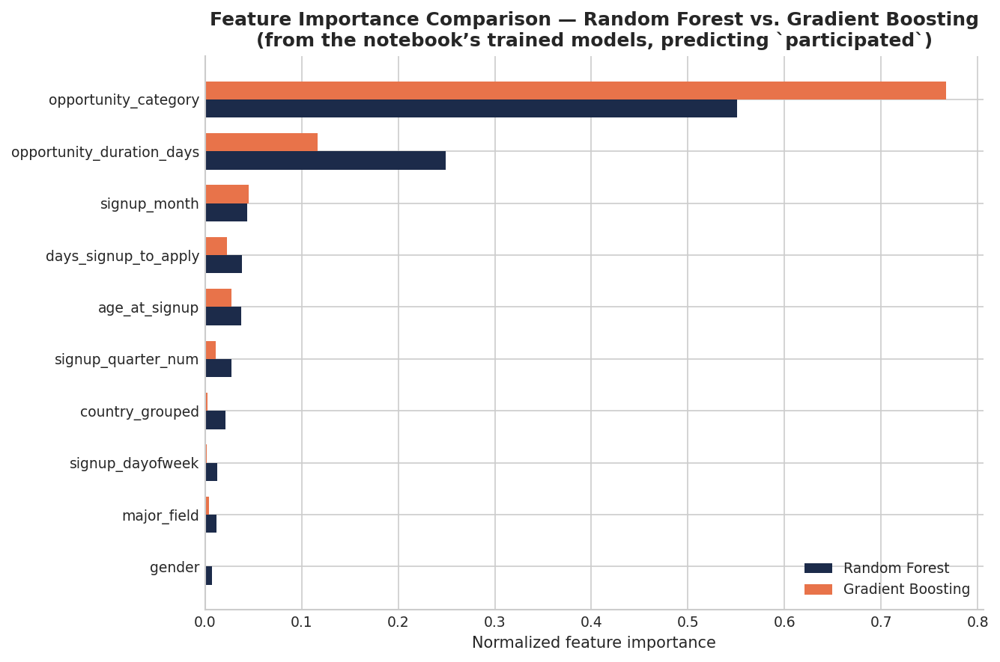

Within Internships, **Non-STEM applicants convert at about 1.5x the rate of STEM applicants** (29.7% vs 19.6%); all other categories stay high regardless of major.

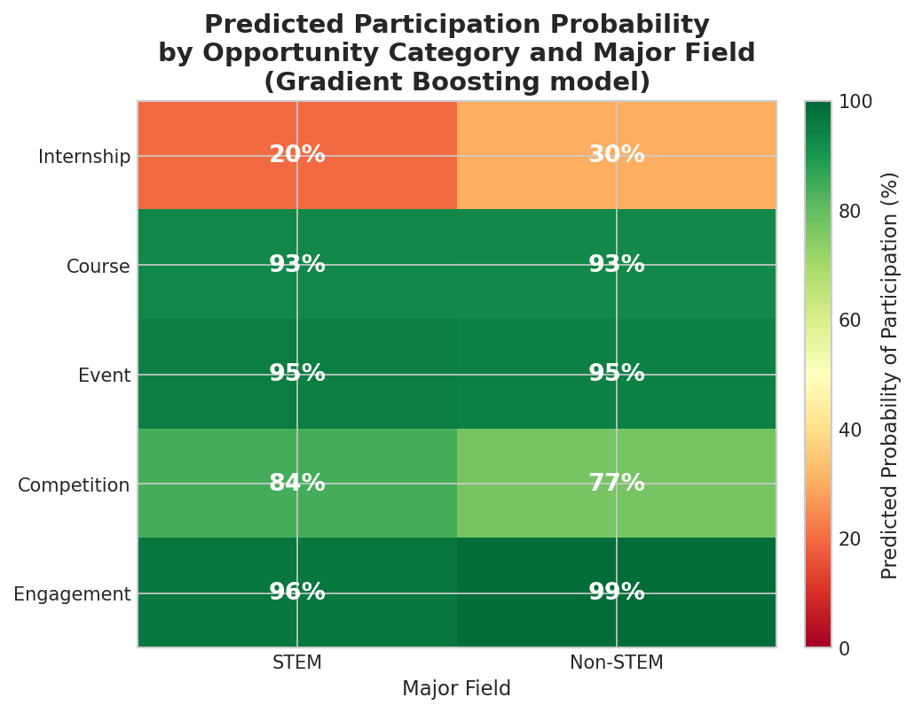

---

## 4. Forecast

Volume and participation rate were projected with simple, transparent methods (a seasonal-naive projection for months, linear regression for quarters). These are **directional estimates, not confidence-bounded predictions**. The linear projection of roughly 6% participation for Q3 2024 is an aggressive stress case, not a plan-against forecast.

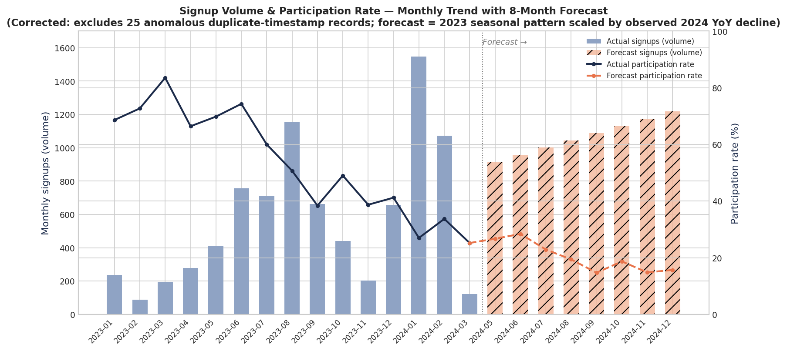

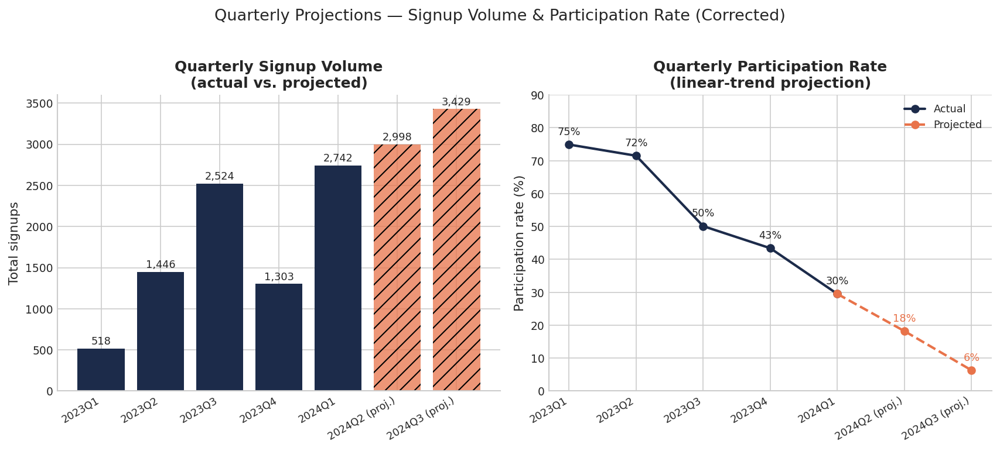

Quarterly volume rose from 518 to 2,742 applications while participation fell from 75% to 30%: the applicant funnel is widening faster than allocation capacity.

---

## 5. Recommendations

1. **Investigate the Internship allocation process.** The models explain *what* happens far better than *why*.
2. **Study the positive outliers.** Health Care Management and the Non-STEM Internship segment are concrete cases worth a closer qualitative look.
3. **Do not target by demographics.** Gender, country and major add little predictive value; redirect that effort to program structure, duration and timing.
4. **Treat launch timing and opportunity type as one lever**, since timing is confounded with category.
5. **Choose the model by error cost** (Random Forest for outreach, Gradient Boosting for capacity planning), and retrain quarterly as new cohorts resolve.
6. **Revisit the forecasts** once a second full year of data is available.

---

## Limitations

- Short data history (about 15 complete months) limits forecasting.
- Some source fields (timestamps, institution names) needed manual correction and carry residual risk.
- Figures differ slightly between weekly reports because they use different date fields (apply date vs. sign-up date) and different stages of the feature set (16 original variables, 34 after feature engineering, 29 in the final modeling file). **The Week 3 report is the reference for model and forecast numbers.**

---

## AI-Assisted Workflow

Claude was used as an analytical co-pilot for data-quality checks, exploratory analysis, interpretation and report drafting. Outputs were verified against the raw data, and the team reviewed and approved all final findings.

## Tools

Python (pandas, numpy, scikit-learn, matplotlib)

## Team

Bisma Memon · Edikan Udoh · Mercy Wanjiku Muigai · Michael Ojiakor · Precious Udeze · Premjeet · Sandleen Sethi

## My Contributions (Sandleen Sethi)

- **Week 1:** Opportunity category analysis, covering the category distribution, outcome framework and the Internship bottleneck finding.
- **Week 2:** Feature importance analysis
- **Week 3:**  Interpretation of findings.
- **Week 4:** Actionable recommendations for program stakeholders.
